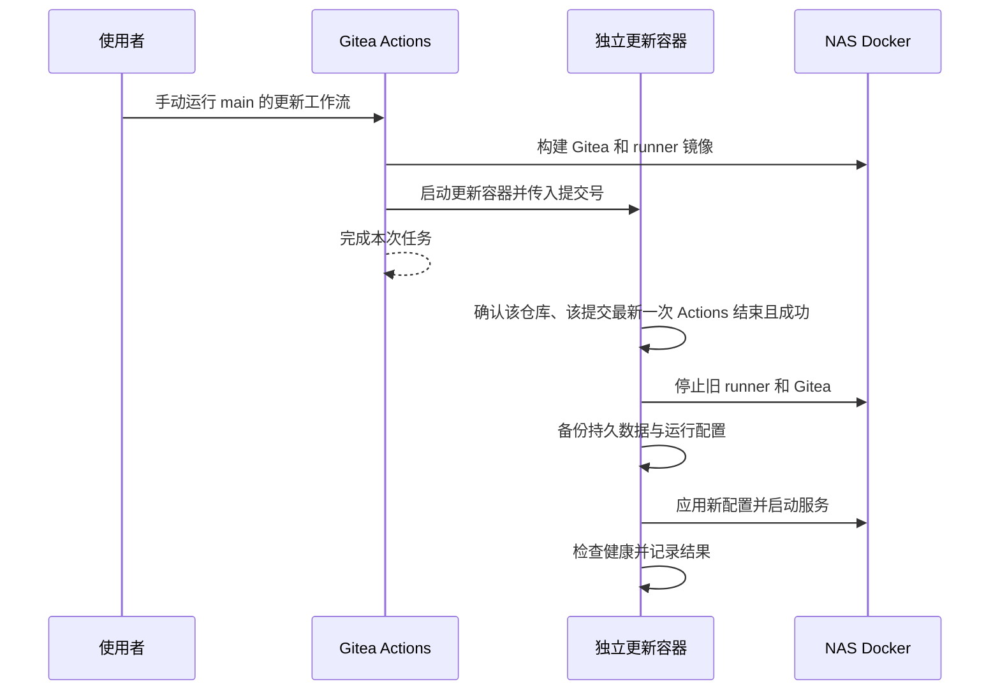

今天整理了一下家里 NAS 上的 CI/CD，把业务服务的构建和部署放回了各自的仓库，通过 Gitea Actions 在 NAS 上完成发布。

业务跑通之后，又顺手把 Gitea 和 runner 的更新也做了进去。这样一来，平时改业务代码可以推送后自动部署，改基础设施则手动运行一次 Action。期间遇到了容器挂载、代理和更新 runner 自己的问题，在这里记录一下。

<!-- more -->

## 项目自己维护部署

原先 NAS 上有两个仓库，分别放镜像构建和 Compose 配置，叫作 `nas-images` 和 `nas-compose`。这次调整后，我希望一个业务项目从源码到运行方式，都能在自己的仓库里找到。

以一个 Rust 服务为例，下面简称为 `rust-server`，与部署有关的文件就是这几个：

```text
rust-server/
├── src/
├── Cargo.toml
├── Cargo.lock
├── Dockerfile
├── compose.yaml
└── .gitea/workflows/deploy.yaml
```

Dockerfile 负责怎样构建、怎样启动；Compose 定义端口和数据目录等运行参数；workflow 把构建与发布串起来。修改业务时，对应的部署改动可以一起提交，不需要再去另一个仓库找配置。

底层还是 Docker Compose。我只有一台 NAS，镜像就在这台机器上构建，也在这台机器上运行，因此暂时省去了推送镜像仓库、再拉取的过程。

## Runner 里的 host 是谁

Gitea 和 runner 都运行在容器中。runner 注册了一个 `alpine3` 标签，配置如下：

```yaml
runner:
  capacity: 1
  labels:
    - alpine3:host
```

workflow 使用 `runs-on: alpine3`，任务便会直接在 runner 所在环境中执行。这里的 `host` 指的是 **runner 容器本身**，NAS 宿主机不会直接执行这些步骤。[官方文档](https://docs.gitea.com/1.26/usage/actions/act-runner/#labels)也专门说明了这个区别。

为了让任务能管理 NAS 上的容器，我把 Docker socket 挂载给了 runner，并在 runner 镜像中放入 Docker CLI 和 Compose。命令在 runner 里执行，实际连接的是 NAS 的 Docker daemon。

以这个 Rust 项目为例，整个过程可以理解为：

```text
Gitea 收到 push
  → runner checkout 对应提交
  → runner 执行 docker build
  → NAS Docker 在构建容器里运行 cargo build
  → 生成业务运行镜像
  → Compose 更新 NAS 上的业务容器
```

所以 runner 不需要为了这个项目安装 Rust。项目 Dockerfile 使用多阶段构建，在 Rust 镜像里编译，再把程序复制到 Debian slim 镜像中，最终运行镜像只保留程序和运行依赖。

能执行 workflow 的代码，也就能通过 socket 操作 NAS 上的 Docker。

## 把发布过程收进一个命令

如果每个业务仓库都复制一份部署脚本，后续改健康检查或镜像清理时，还是得挨个修改。所以我把共同的部分放进 runner，提供了一个 `nas-deploy` 命令。

这是自己实现的小工具，负责读取业务 Compose，再完成构建和发布。`rust-server` 的工作流如下：

```yaml
name: Build and deploy Rust Server

on:
  push:
    branches:
      - master

jobs:
  deploy:
    runs-on: alpine3
    steps:
      - name: Checkout the triggering commit
        uses: https://github.com/actions/checkout@v4
        with:
          ref: ${{ gitea.sha }}
          persist-credentials: false

      - name: Build and deploy
        run: >-
          nas-deploy
          --project rust-server
          --image nas/rust-server
          --tag "${{ gitea.sha }}"
```

这里显式 checkout 触发工作流的提交，镜像 tag 也使用同一个提交号，方便对应到实际发布的代码。分支名只负责决定何时触发，不拿来当反复覆盖的镜像版本。

`nas-deploy` 默认读取当前目录的 Dockerfile 和 `compose.yaml`，也可以通过参数指定其他位置。对应的 Compose 仍然由业务维护：

```yaml
services:
  rust-server:
    image: ${NAS_DEPLOY_IMAGE:?Use nas-deploy or set NAS_DEPLOY_IMAGE}
    container_name: rust-server
    ports:
      - '23100:20022'
    volumes:
      - /volume1/docker/rust-server/config:/app/config
    restart: unless-stopped
```

命令会设置 `NAS_DEPLOY_IMAGE`，将目标服务指向刚构建的镜像。端口映射和目录挂载都按 Compose 应用，环境变量、启动参数或健康检查也可以在业务配置中定义。多个服务的项目需要通过 `--service` 明确选择，发布只更新这个服务，不顺带重建依赖。

### 挂载路径属于 NAS

这里有个容易混淆的地方。Compose 虽然是在 runner 里解析，但 bind mount 的源路径由 NAS 上的 Docker daemon 解释，必须指向 NAS 文件系统中的正确位置。

比如上面的 `/volume1/docker/rust-server/config`，就是 NAS 的业务配置目录。不能把 runner 临时 checkout 中的 `./config` 当作宿主机上的业务目录，两边看到的文件系统并不一样。

命名卷也要注意 Compose 项目名。改了项目名，可能就对应到另一组卷和网络。接入已有服务时，我就保留了原来的项目名和镜像名，先把部署过程接上。

新版会根据 `owner/repo` 推导默认项目名和镜像名，例如 `daief/rust-server` 对应项目 `daief_rust-server`，镜像为 `nas/daief_rust-server`，避免不同用户的同名仓库互相混淆。显式指定的名称仍然优先，已有容器和数据不会自动迁移。上面的 workflow 显式设置了 `--project` 和 `--image`，所以更新 runner 后仍会沿用原来的名称。

### 健康检查之后才记录成功

部署先校验 Compose，再构建镜像并更新容器，接着等待健康检查。通过之后，才记录本次成功版本，并清理之前由这个工具管理的镜像。

项目镜像已经定义了 `/healthz` 的检查。其他项目也可以提供 `--check-url`。没有健康检查时，也可以显式使用 `--allow-running`，以容器短时间内保持运行作为较弱的成功判据。

清理范围同样需要限定。工具只处理自己记录过、镜像 ID 和归属都匹配的历史镜像，仍被其他容器引用的会跳过。数据卷和构建缓存都不在这个清理范围内。

当前选择是失败就报错，留下现场，修复代码或者回退提交后重新部署。更新失败后服务可能不可用，需要自己处理。

## 把工具和代理放在 runner 里

任务能执行之后，接下来就是环境问题。

我在 runner 中加入了 mise 用来管理 Node 和 uv 等开发工具（好用、跨平台，十分推荐）。业务项目有其他版本要求时，可以自己提供 mise 配置。Rust 项目继续由 Dockerfile 决定构建环境，两种方式并不冲突。

工具是在构建 runner 镜像时预装的，但持久化目录又带来了一个问题：直接把工具装到 `/data`，运行时挂载的卷会把镜像中的同路径内容遮住。

目前的处理是在镜像中保留一份 `/opt/nas-ci/seed`，启动时合并到 `/data/tool-cache`，再生成 shims，并刷新默认版本的别名。这样重建 runner 时可以继续使用缓存，也能拿到新镜像预装的工具，不需要每次启动再下载一遍。

代理和语言镜像源统一放在 runner 的配置中，业务 workflow 不再写 NAS 的代理地址。不过 Docker 拉取基础镜像还涉及 daemon 自身的代理，单改 runner 环境变量是不够的。这次就碰到了宿主机 Docker 仍指向旧代理端口的问题，修正后才恢复正常拉取。

## 更新 Gitea 和 runner 自己

业务服务跑通之后，自然又想把 Gitea 和 runner 的配置也纳入同样的流程，于是单独建了 `nas-gitea` 仓库。

但这里不能直接照搬业务发布。假如 Action 里直接替换 runner，执行到一半任务就把自己停了；Gitea 自己也要更新，任务状态还没来得及保存，服务可能就已经退出了。

所以这部分分成两段。Action 先构建新镜像，再启动一个独立的更新容器。更新器查询该仓库、该提交最新一次 Actions 运行的状态，确认结束且成功后，再停止旧服务并应用更新。



更新工作流仅手动触发，更新任务只在所选分支为 `main` 时执行：

```yaml
name: Update Gitea infrastructure

on:
  workflow_dispatch:

jobs:
  update:
    if: ${{ gitea.ref == 'refs/heads/main' }}
    runs-on: alpine3
    steps:
      - uses: https://github.com/actions/checkout@v4
        with:
          ref: ${{ gitea.sha }}
          persist-credentials: false

      - name: Build images and queue update
        run: >-
          python3 scripts/queue_update.py
          --sha "${{ gitea.sha }}"
          --repository "${{ gitea.repository }}"
```

这里还有一个区别：**Action 成功，只代表镜像构建和更新任务排队成功。** 真正替换服务发生在后面，最终要看独立更新器的状态。

我把状态和日志保存在 NAS 的持久目录下，更新容器结束后自动删除，文件仍然保留：

```text
/volume1/docker/gitea/runner/volume-data/
└── updates/nas-gitea/<commit>/
    ├── status.json
    └── update.log
```

当前更新器通过只读查询 Gitea 的 SQLite 数据库确认 Actions 状态。这是针对自己这套环境的实现，换数据库或升级后表结构发生变化时，还需要调整这部分。

### 更新前先停下来备份

Gitea 的数据中包含数据库和 Git 仓库，还有配置与密钥。更新器会先停止 Gitea，再把完整持久目录打包，同时保存原来的 Compose 和 `.env`，备份目录带上时间与提交号。

数据库升级之后，简单切回旧镜像不一定能恢复。所以这里也没有自动回滚；如果需要降级，就得人工恢复对应的升级前备份。

### 健康检查也走了代理

第一次试跑自更新时，健康检查出了问题。Gitea 镜像里的 BusyBox wget 没有按预期遵循 `NO_PROXY`，对 `127.0.0.1` 的检查也走向了代理，导致更新失败。

最后在健康检查中显式关闭代理：

```sh
wget -Y off -q -O /dev/null http://127.0.0.1:3000/api/healthz
```

同时把健康检查的 `start-period` 调整为 180 秒，给数据库迁移留出启动宽限期。修改后再次运行，Gitea 和 runner 都通过了健康检查，独立更新器也记录了 `succeeded`。

## 结语

目前业务项目已经通过 Actions 实际发布，Gitea 和 runner 也完成了一次自更新。后续业务主要维护自己的 Dockerfile 和 Compose，基础设施的变化则集中到 `nas-gitea` 中，部署入口总算清楚了一些。

这套实现依赖单台 NAS 的本地 Docker，发布时会重建容器，也没有做零停机切换。对我自己的几个服务而言，暂时已经够用了，可以丝滑地自动部署了。
