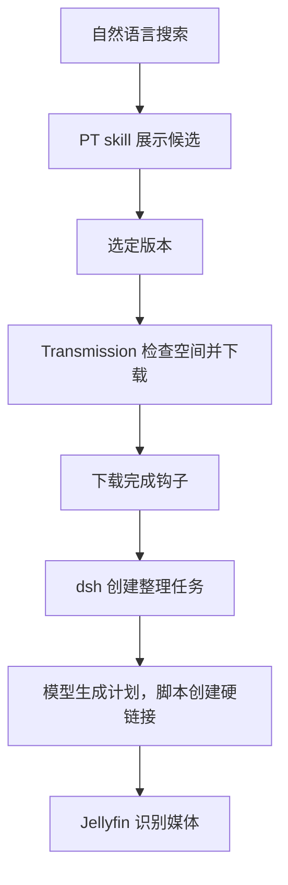

最近在 NAS 上部署了一个 DeepSeek Harness，接上 PT 站、Transmission 和 Jellyfin，想试试通过自然语言完成找资源、添加下载，再把下载好的文件整理进媒体库。

NAS 上已经有下载器和媒体库，这次主要是给它们增加一个共同的对话入口。比如告诉它想找什么电影，看看搜索结果，再选一个版本下载；后续的文件整理也交给它处理。

从搜索到下载，再到整理入库，整个流程已经实测走通，记录一下这次的搭建大概。

<!-- more -->

## 把 Harness 放到 NAS 上

[DeepSeek Harness](https://github.com/deepseek-ai/deepseek-harness)（以下简称 dsh）是 DeepSeek 开源的 agent harness。这次用它提供 Web 入口，在 NAS 上运行模型任务，并通过工作区里的 skills 调用已有工具。

我想让它处理的事情都发生在 NAS 上：下载器在那里，媒体文件也在那里，因此直接把 Harness 部署过去，文件操作和任务运行就可以留在同一台设备上，本机只负责打开浏览器。

部署采用 Docker，沿用已有的 NAS 部署流程，平时通过浏览器访问。

持久化分为三部分：dsh 的配置和会话、工作区，以及需要处理的下载文件。如此一来，更新容器之后，原来的会话、skills 和文件还在。

我在工作区里建了一个专门管理影视资源的项目。以后想看什么，直接在这里说，不用再挨个打开 PT 站点找资源，下载种子后再手动导入下载器。

## 从找资源开始

接下来给它添加三个 skills，分别处理 PT 站、Transmission 和媒体文件整理。`AGENTS.md` 负责说明什么请求应该使用哪个 skill，具体操作交给对应脚本。

使用时先说想找什么，看到候选之后再决定下载哪个。下面是交互示意：

```text
帮我找一下想看的电影
→ 展示 PT 搜索结果

下载第 2 个
→ 获取对应种子，检查空间并添加到 Transmission

看看现在的下载进度
→ 查询 Transmission 任务
```

用户不需要记住 skill 的名字，也不用自己把 PT 下载链接转交给下载器。模型根据当前对话确定目标，由 PT skill 获取私有种子，再调用 Transmission skill 添加任务。

搜索结果里，我比较关心资源大小、做种人数和是否免费，也希望能看到上传与下载倍率、免费剩余时间，方便自己选版本。

这里只说“搜索”不会自动开始下载。选定某一条，或者明确让它按条件代选，才继续添加任务。免费状态也只是查询时的结果，下载时促销是否还在，需要按站点实际情况看。

## 下载之后，交给 Jellyfin

下载由已有的 Transmission 继续负责，skill 通过 RPC 添加和查询任务，无需为此额外启动一个服务。

添加下载前会检查可用空间，确认够用再启动，避免一句“帮我下载”就把 NAS 塞满。

媒体整理用的是硬链接。这样可以保留下载侧的原始目录用于做种，同时给 Jellyfin 提供另一套便于识别的文件名，也不用再复制一份媒体内容。

下载完成后，通过 Transmission 的完成钩子把本次资源提交给 dsh。这里利用的是 Transmission 已有的[完成时调用脚本](https://github.com/transmission/transmission/blob/4.0.6/docs/Scripts.md)的能力，不需要一直扫描下载目录。

之后由模型判断文件名中的片名、年份或者季集信息，生成整理计划，再由脚本检查并创建硬链接。Jellyfin 继续按自身配置识别和刮削，整理 skill 负责把文件放到合适的位置。



这套流程是我自己用 skills 和脚本串起来的，需要单独维护这些衔接部分。

容器挂载时，需要让下载目录和媒体库能够互建硬链接。我这里最终挂载了共同的父目录，避免独立挂载点带来的限制，具体可参考 [link(2)](https://man7.org/linux/man-pages/man2/link.2.html)。

## 给它一个明确的工作范围

把 Harness 放在 NAS 上之后，文件操作会直接影响实际存储，所以工作区里的约定也需要跟着具体起来。

比如，我只希望新下载进入整理流程，已有的媒体库默认保持原样，只有明确要求时才整理旧资源。

普通下载不进入媒体整理流程。模型遇到无法确定的剧集编号就跳过，目标位置有其他文件也不覆盖。

PT 账号与下载器密码由脚本自行读取，不需要展示给模型。

这些约定写进 `AGENTS.md` 和 skill 使用说明，路径检查与文件冲突等规则再落实到脚本里。提示词可以告诉模型应该怎么做，实际文件操作仍然要有自己的校验。

这套部署目前只在可信内网使用，能够访问服务的设备可以通过它操作挂载的文件，访问范围也需要相应控制。

## 用起来之后

这次折腾让我觉得，NAS 上很适合放一个有明确用途的 Harness。设备本来就常开，文件和服务也都在那里，接上几个日常需要的能力，就有了一个可以持续使用的场景。

方便了我自己，现在老婆也能直接告诉它想看什么，自助找资源、下片，不用再让我帮忙操作下载器和整理文件了。

找片只是这次接上的一个用途，其实早就想做了，懒癌犯了拖了好久，加上现在模型编程能力比以前进步太多，做起来方便多了。
